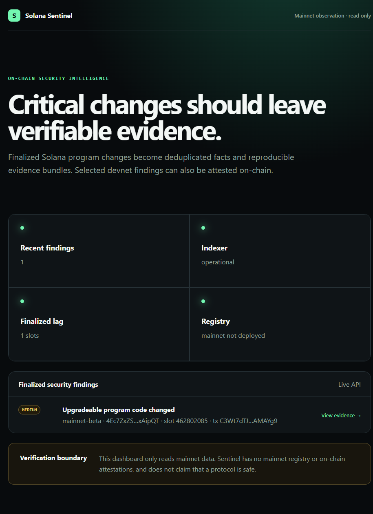

# Solana Sentinel

Solana Sentinel — портфолио-MVP системы наблюдения за критическими изменениями Solana-программ. Она сохраняет события и проверяемые evidence hashes; отдельный реестр позволяет публиковать findings в devnet. Бесплатный локальный режим читает mainnet без отправки транзакций.

> Текущий статус: registry развёрнут в devnet, а две реальные смены upgrade authority прошли цепочку RPC polling → finding → on-chain attestation → независимый verifier. Локальный read-only pilot Jupiter Swap V6 проверен на mainnet; историческая находка сохранена в PostgreSQL и показана в панели 10 ноября. Yellowstone live E2E, mainnet deployment, production monitoring и verified build **не выполнялись**. GitHub Actions CI заблокирован состоянием billing аккаунта; локальные проверки прошли.

## Портфолио-демо

Панель показывает состояние локального наблюдателя и историческое обновление Jupiter Swap V6. Нажатие на находку открывает Event ID, evidence hash и ссылку на исходную транзакцию. Это **исторический импорт**, не обнаружение события в реальном времени.



Снимок локального запуска 10 ноября 2026 года; он не подтверждает постоянную доступность.

[Экран доказательств](docs/assets/sentinel-evidence.png) · [Кейс и исходные данные](docs/case-study-jupiter-mainnet.ru.md) · [Подробный SDD](docs/SDD.ru.md)

На компьютере с работающими PostgreSQL, API, индексатором и панелью проверка демо выполняется одной командой:

```bash
pnpm portfolio:check
```

Команда сверяет локальную запись с сохранённым Jupiter evidence, заново вычисляет SHA-256, проверяет состояние индексатора и обе страницы. Она не отправляет транзакций. Для запуска пилота в новом клоне есть [.env.mainnet.example](.env.mainnet.example) и [инструкция](docs/mainnet-observation.ru.md); публичный RPC может не отдать старую транзакцию для повторного импорта.

## Что уже есть

- детерминированные event ID и канонические evidence hashes;
- loader-v3 account и transaction instruction decoders;
- Yellowstone finalized stream с replay/reconnect и корреляцией transaction/account;
- RPC reconciliation с durable signature cursor и защитой от необнаруженного большого gap;
- идемпотентный replay pipeline и fixture tests;
- PostgreSQL schema с event log, snapshots, findings, attestations, checkpoints и outbox;
- versioned detection rules и атомарное сохранение evidence-backed findings;
- Anchor registry и TypeScript SDK/verifier: initialize, immutable finding, publisher rotation, correction;
- fail-closed publisher, безопасная доставка подписанных webhooks;
- Fastify API и runtime Next.js dashboard;
- Docker Compose, Dev Container, VS Code workspace/tasks/launch;
- CI для TypeScript, Rust и повторного применения миграций.
- local-validator suite для публикации, исправлений и ротации publisher (6 сценариев локально прошли).
- отдельный read-only verifier CLI для сравнения API evidence с Finding PDA и finalized signatures.

## Быстрый старт

Требования: Node.js 24+, pnpm 11.25+, Rust 1.98.1, Docker. Solana/Anchor CLI нужны для будущих local-validator тестов, но не для off-chain unit tests.

```bash
pnpm install
pnpm db:up
pnpm db:migrate
pnpm build
pnpm test
cargo test --workspace
pnpm --filter @sentinel/indexer start -- --replay tests/fixtures/account-updates.json
```

Для RPC recovery укажите `WATCHED_PROGRAM_IDS` и выполните:

```bash
pnpm --filter @sentinel/indexer start -- --reconcile
```

Без Yellowstone можно запустить непрерывное наблюдение за loader-v3 программами через бесплатный devnet RPC:

```bash
pnpm --filter @sentinel/indexer start -- --poll-rpc
```

Режим опрашивает finalized историю каждые 30 секунд и сохраняет checkpoint. Он ограничен лимитами публичного RPC и не восстанавливает исторические bytes обычных watched accounts; `WATCHED_ACCOUNT_IDS` в этом режиме запрещён. На двух devnet транзакциях проверена цепочка наблюдения и публикации для смены upgrade authority.

На этом компьютере настроен бесплатный read-only mainnet pilot для Jupiter Swap V6. Он использует другую локальную базу и не публикует on-chain записи. Настройки, проверенный результат 6 ноября и команды повторного запуска: [mainnet observation](docs/mainnet-observation.ru.md).

Историческая транзакция обновления Jupiter Swap V6 воспроизводится с учётом вложенной loader-v3 инструкции. [Кейс и evidence](docs/case-study-jupiter-mainnet.ru.md) включают локальный `dry-run`, проверку повторного импорта и отображение находки в панели.

Live mode дополнительно требует `YELLOWSTONE_ENDPOINT` и, если нужен провайдеру, `YELLOWSTONE_X_TOKEN`. Нативный Yellowstone client запускайте в Linux/Dev Container; текущий пакет не поставляет Windows N-API binary.

Для VS Code откройте `solana-sentinel.code-workspace`.

## Структура

```text
apps/       indexer, API, publisher gate, notifier, verifier, web
packages/   core, evidence, config, database, Solana adapters, registry SDK
programs/   Anchor program sentinel_registry
infra/      PostgreSQL migrations and Docker
docs/       SDD, threat model, runbook, ADR
tests/      replay fixtures
```

## Границы результата

Портфолио-MVP и контролируемый devnet E2E для смены upgrade authority выполнены. Local-validator suite прошёл 6 сценариев. Yellowstone stream и исторические watched-account bytes требуют отдельной проверки. Локальное наблюдение работает только при включённом компьютере; публичный RPC ограничен и не подходит для production. Реальные адреса, подписи и ограничения: [отчёт devnet](docs/devnet-validation.ru.md).

Подробности: [Software Design Document](docs/SDD.ru.md), [threat model](docs/threat-model.ru.md), [runbook](docs/runbook.ru.md).

## Лицензия

Apache-2.0.
