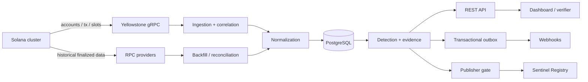

# Solana Sentinel — Software Design Document

| Поле                        | Значение                                      |
| --------------------------- | --------------------------------------------- |
| Версия                      | 0.1.0 Foundation                              |
| Дата                        | 6 ноября 2026                                 |
| Статус                      | Devnet pilot, authority-change E2E verified   |
| Авторы                      | Solana Sentinel contributors                  |
| Язык нормативных требований | Русский; ключевые идентификаторы — английские |

## 1. Назначение документа

Документ задаёт проверяемую архитектуру Solana Sentinel: границы MVP, модель данных, контракты компонентов, инварианты on-chain программы, отказоустойчивость, безопасность, тестирование и критерии перехода к devnet/mainnet.

Он описывает как целевое состояние, так и фактически реализованный foundation. Формулировки «должен» относятся к требованиям. Они не означают, что функция уже работает в production. Фактический статус приведён в разделе 17.

## 2. Проблема и цели

Код upgradeable Solana-программы, upgrade authority и критический account могут измениться. Обычное уведомление недостаточно: пользователю нужны транзакция, slot, состояние до/после, источник данных и воспроизводимый hash доказательств.

Цели MVP:

1. Обнаруживать `PROGRAM_UPGRADED` для loader-v3 ProgramData.
2. Обнаруживать `UPGRADE_AUTHORITY_CHANGED`, включая отзыв authority.
3. Фиксировать `WATCHED_ACCOUNT_CHANGED` без заявления, что любое изменение опасно.
4. Переживать повторную доставку, reconnect и restart без дубликатов и тихих пропусков.
5. Сохранять chain facts отдельно от выводов security rules.
6. Создавать канонический evidence bundle и SHA-256 commitment.
7. Публиковать только выбранные finalized findings в `sentinel_registry`.
8. Давать независимому verifier достаточно данных для повторной проверки.

Не-цели MVP:

- предотвращение атак или гарантия безопасности протокола;
- custody, депозиты, торговля, ликвидации или управление чужими активами;
- универсальная семантическая оценка любого account;
- «AI risk score» без проверяемых правил;
- запись каждого наблюдения on-chain;
- mainnet deployment до devnet E2E и security gate.

## 3. Пользователи и сценарии

| Роль                | Сценарий                          | Проверяемый результат                    |
| ------------------- | --------------------------------- | ---------------------------------------- |
| Protocol operator   | Следит за собственной программой  | finalized finding с tx/slot и evidence   |
| DeFi integrator     | Следит за dependency              | webhook/API событие без дубликатов       |
| Security researcher | Анализирует историю authority     | снимки и последовательность фактов       |
| Public verifier     | Проверяет attestation             | совпадение локально рассчитанного hash   |
| SRE                 | Диагностирует остановку ingestion | checkpoint, finalized lag, health reason |

## 4. Системный контекст и границы доверия



Внешние недоверенные входы: gRPC, RPC, webhook destinations, пользовательские query params и содержимое наблюдаемых accounts. PostgreSQL — backend source of truth, но не корень истины о chain. On-chain registry — публичный журнал commitments оператора, но не oracle истинности.

Admin registry, publisher и deployment authority — разные роли. Компрометация publisher не должна давать право обновлять программу или менять admin.

## 5. Архитектурные решения

### 5.1 Модульный monorepo

Процессы разделены логически, но живут в одном репозитории. Это обеспечивает атомарные изменения типов, схемы и тестов. Выделение сетевых микросервисов допускается после появления независимого масштабирования или отдельного blast radius.

### 5.2 Yellowstone для real time, RPC для восстановления

Yellowstone снижает latency, но не является durable queue Sentinel. Каждый reconnect инициирует reconciliation от durable checkpoint до актуального finalized slot. Cursor нельзя продвигать раньше атомарного сохранения обработанного диапазона.

Для бесплатной devnet-проверки доступен режим `--poll-rpc`: каждые 30 секунд он сверяет finalized подписи наблюдаемых loader-v3 ProgramData accounts, сохраняет checkpoint и heartbeat. Этот режим не получает исторические bytes обычных watched accounts, ограничен rate limits и сроком хранения RPC history; при недоступном сохранённом cursor останавливается. Он не заменяет Yellowstone для полного live coverage.

### 5.3 PostgreSQL и transactional outbox

PostgreSQL хранит нормализованные факты, findings, evidence, checkpoints и delivery state. Redis не требуется для корректности foundation. Notification создаётся в той же транзакции, что finding; worker получает записи через `FOR UPDATE SKIP LOCKED` и идемпотентный destination key.

### 5.4 Provisional и finalized

`processed`/`confirmed` допускаются только для предварительного UI. Durable finding и on-chain publication требуют `finalized`. Если предварительная ветка исчезает, она помечается reverted, а не становится finalized.

### 5.5 Отдельные loader adapters

Loader-v3 декодируется по его формату Program/ProgramData. Loader-v4 будет отдельным adapter и набором fixtures. Нельзя применять layout v3 к v4 по эвристике.

## 6. Компоненты и контракты

### 6.1 Indexer

Ответственность:

- поддерживать подписки accounts, transactions и slots;
- связывать Program с ProgramData;
- коррелировать account write с транзакцией;
- нормализовать slot, signature, commitment и before/after;
- сохранять событие и checkpoint идемпотентно;
- запускать reconciliation после разрыва.

Indexer не присваивает бизнес severity и не отправляет webhooks напрямую.

### 6.2 Solana adapters

Adapter принимает сырые bytes и метаданные конкретного loader/protocol. Результат не должен зависеть от локального времени. Ошибка декодирования сохраняется как диагностический факт и метрика, а не преобразуется в «без изменений».

### 6.3 Detection и evidence

Detection читает chain fact и применяет версионированное правило. Evidence bundle содержит schema version, event ID, источники, факты и rule version. Канонизация сортирует object keys, не допускает `undefined`, NaN и Infinity. Hash: SHA-256 от UTF-8 canonical JSON.

### 6.4 API

Минимальные endpoints:

- `GET /health/live` — жив ли процесс;
- `GET /health/ready` — доступна ли БД;
- `GET /v1/events` — последние нормализованные события;
- целевые: `/v1/findings`, `/v1/findings/:id/evidence`, `/v1/status`.

Live health не доказывает свежесть индексатора. `/v1/status` обязан показывать checkpoint slot, observed finalized slot и lag.

### 6.5 Notifier

Notifier забирает outbox item, проверяет destination policy, отправляет с timeout, сохраняет попытку и применяет bounded exponential backoff. Redirect на private/reserved IP запрещён. DNS проверяется перед каждым соединением и после redirect.

### 6.6 Publisher

Publisher выбирает только finalized loader-v3 finding, повторно вычисляет evidence hash, сверяет исходную finalized транзакцию и registry через два RPC и проверяет отсутствие существующего PDA. В текущем коде он fail-closed и выключен по умолчанию. Контролируемый devnet E2E для смены upgrade authority выполнен на двух findings; ошибки RPC или mismatch блокируют публикацию. Публикация generic watched-account findings остаётся закрытой до независимой проверки их исторических данных.

### 6.7 Dashboard/verifier

UI различает факт, finding и attestation. Пустое состояние не заменяется демонстрационными mainnet цифрами. Verifier получает bundle, пересчитывает hash, читает Finding PDA и показывает каждую проверку отдельно.

## 7. Нормализованное событие

```ts
type ChainEvent = {
  eventId: string; // sha256 hex
  type: "PROGRAM_UPGRADED" | "UPGRADE_AUTHORITY_CHANGED" | "WATCHED_ACCOUNT_CHANGED";
  cluster: "localnet" | "devnet" | "testnet" | "mainnet-beta";
  targetAddress: string;
  programAddress?: string;
  signature: string;
  slot: number;
  commitment: "processed" | "confirmed" | "finalized";
  observedAt: string;
  beforeHash?: string;
  afterHash: string;
};
```

Event ID v1:

```text
sha256("solana-sentinel:event-id:v1" || NUL || cluster || NUL ||
       targetAddress || NUL || signature || NUL || eventType)
```

Изменение формулы требует новой domain/version. Event ID не зависит от времени получения, RPC provider или порядка доставки.

## 8. Loader-v3 detection

Upgradeable Loader State использует discriminant и варианты `Uninitialized`, `Buffer`, `Program`, `ProgramData`. Program account указывает на ProgramData. ProgramData содержит slot последнего deploy, optional upgrade authority и bytecode.

Алгоритм:

1. RPC подтверждает owner Program account как loader-v3.
2. Adapter извлекает ProgramData address.
3. Подписки включают ProgramData account и релевантные transactions.
4. Для write извлекаются before/after finalized states.
5. Изменение optional authority даёт `UPGRADE_AUTHORITY_CHANGED`.
6. При неизменной authority изменение bytecode hash даёт `PROGRAM_UPGRADED`.
7. Одинаковые bytes игнорируются.
8. Транзакция, slot и target проходят повторную RPC-проверку.

Одной подписки на Program ID недостаточно: upgrade меняет ProgramData.

## 9. PostgreSQL model и транзакции

Основные таблицы находятся в `infra/migrations/0001_foundation.sql`.

| Таблица                 | Инвариант                           |
| ----------------------- | ----------------------------------- |
| `watched_programs`      | один program/cluster configuration  |
| `chain_events`          | уникальный deterministic event ID   |
| `account_snapshots`     | уникальный address/slot/hash        |
| `findings`              | одно rule result на event/rule      |
| `attestations`          | одна publication на finding         |
| `ingestion_checkpoints` | монотонный finalized slot на source |
| `notification_outbox`   | одна доставка finding/destination   |

Целевая ingestion-транзакция:

1. `INSERT chain_event ON CONFLICT DO NOTHING`.
2. Сохранить нужные snapshots.
3. Выполнить deterministic rules и вставить findings.
4. Вставить outbox rows.
5. Продвинуть checkpoint только вперёд.
6. Commit.

Повтор операции обязан давать то же состояние.

## 10. On-chain registry

### 10.1 Accounts

| PDA              | Seeds                           | Содержание                                      |
| ---------------- | ------------------------------- | ----------------------------------------------- |
| `RegistryConfig` | `['registry']`                  | schema, admin, publisher                        |
| `Finding`        | `['finding', event_id]`         | target, slot, kind, evidence hash, tx signature |
| `Correction`     | `['correction', correction_id]` | original ID, corrected hash, reason hash        |

### 10.2 Instructions

- `initialize_registry(publisher)` — создаётся один config; admin платит rent.
- `publish_finding(...)` — только текущий publisher; PDA создаётся один раз.
- `rotate_publisher(new_publisher)` — только admin.
- `publish_correction(...)` — новая immutable запись со ссылкой на существующий finding.

### 10.3 Инварианты

1. Admin и publisher различны и не равны default pubkey.
2. Finding не обновляется и не закрывается.
3. Duplicate event ID упирается в уже существующий PDA.
4. Correction не удаляет и не переписывает оригинал.
5. Программа не принимает token accounts, не делает CPI в DeFi и не хранит депозиты.
6. Размер accounts ограничен фиксированными полями.
7. Program ID в source закреплён за devnet keypair; для mainnet нужен отдельный ID и key ceremony.

## 11. Согласованность и отказоустойчивость

### 11.1 Reconnect

После stream error процесс сохраняет причину, прекращает считать себя fresh, переподключается с jittered backoff и запускает RPC backfill от последнего committed checkpoint. Новые live events могут буферизоваться, но checkpoint продвигается в slot order.

### 11.2 RPC divergence

Critical finding сверяется минимум с secondary provider. При несовпадении publication блокируется, finding помечается `verification_pending`, создаётся alert оператору.

### 11.3 PostgreSQL outage

Indexer не подтверждает batch и не продвигает cursor. После восстановления тот же диапазон обрабатывается заново. In-memory queue не считается durable.

### 11.4 Poison event

Некорректный event не должен бесконечно блокировать stream. После ограниченного числа попыток он сохраняется в quarantine с raw hash, ошибкой decoder и source position. Пропуск требует alert и видимого gap.

## 12. Security design

### Ключи

- Deployment authority — offline/controlled release path.
- Registry admin — отдельный ключ для редкой rotation.
- Publisher — hot key с минимальным балансом и без upgrade rights.
- CI не получает production ключей для обычных pull requests.

### Network

- TLS для gRPC/RPC/API.
- Секреты только через runtime secret store/env, не в git/logs.
- Webhooks: только `https`, запрет loopback/private/link-local/metadata IP, ограничение redirect и body.
- API: bounded pagination, input validation, rate limit на публичном ingress.

### Supply chain

- Точные версии и lockfiles.
- Minimal GitHub Actions permissions.
- Dependabot и review dependency changes.
- Build provenance и reproducibility проверяются отдельным release gate.

Расширенная таблица угроз — `docs/threat-model.ru.md`.

## 13. Наблюдаемость

Обязательные метрики целевого milestone:

- `sentinel_observed_finalized_slot`;
- `sentinel_checkpoint_finalized_slot`;
- `sentinel_finalized_lag_slots`;
- `sentinel_events_total{type,status}`;
- `sentinel_decoder_errors_total{adapter}`;
- `sentinel_reconciliation_runs_total{result}`;
- `sentinel_outbox_pending` и возраст старейшей записи;
- `sentinel_publication_total{result}`.

Alert возникает не только при падении процесса, но и при отсутствии движения checkpoint при движущемся cluster slot. Логи структурированы и включают event ID/source position, но не токены и key material.

## 14. Тестовая стратегия

### Unit

- event ID deterministic/domain-separated;
- canonical JSON и evidence hash;
- loader-v3 layouts, optional authority и truncated bytes;
- authority/bytecode classification;
- Anchor account size и state enums.

### Integration

- миграции применяются дважды;
- duplicate event не создаёт вторую строку;
- checkpoint и batch commit атомарны;
- outbox retry не дублирует успешную доставку.

### Replay

Набор известных upgrade/authority transactions хранит входы и ожидаемые normalized facts. Один набор прогоняется в исходном, обратном и duplicate порядке. Completeness вычисляется только относительно опубликованного fixture set.

### Anchor/local validator

Позитивные и негативные сценарии: wrong signer, wrong PDA, duplicate finding, forged original, publisher rotation, old publisher after rotation, boundary fields. Эти тесты являются gate перед снятием publisher block.

### Devnet E2E

Контролируемая смена upgrade authority проходит цепочку:

```text
deploy → authority rotation → RPC polling → event → finding → API → registry → verifier
```

Артефакт теста включает реальные devnet signatures и результаты verifier в `docs/devnet-validation.ru.md`. Он не выдаётся за mainnet proof или verified build.

## 15. CI/CD и release gates

CI настроен для format, lint, TypeScript typecheck/tests/build, Rust fmt/clippy/tests и двукратной миграции на чистом PostgreSQL. Последние GitHub Actions jobs не стартовали из-за блокировки billing аккаунта; локальные проверки выполнены отдельно.

Для воспроизводимого devnet release требуются:

- установленных pinned Solana/Anchor CLI;
- local validator integration suite;
- зафиксированного настоящего Program ID;
- release artifact checksums;
- ручного workflow с environment approval.

Переход к mainnet дополнительно требует review threat model, key ceremony, независимой проверки binary/source, operational monitoring и опубликованного incident runbook. `anchor build --verifiable` или иной verified-build результат фиксируется только после фактического выполнения и независимой проверки.

## 16. Performance и SLO (целевые, не достигнутые)

| Метрика                 | Цель после стабилизации        | Метод измерения                       |
| ----------------------- | ------------------------------ | ------------------------------------- |
| Replay completeness     | 100% утверждённого fixture set | expected vs actual IDs                |
| Duplicate findings      | 0                              | repeated/reordered replay             |
| Finalized detection p95 | < 30 s                         | chain finalized time → persisted time |
| API p95                 | < 300 ms                       | production histogram                  |
| Recovery                | 0 gaps в fault-injection test  | checkpoint audit                      |
| Uptime                  | 99.5%                          | external probe + freshness SLI        |

Эти значения не должны появляться как достигнутые без отчёта с периодом, выборкой и окружением.

## 17. Фактический статус на 6 ноября 2026

| Область                      | Статус                                 | Доказательство/ограничение                                  |
| ---------------------------- | -------------------------------------- | ----------------------------------------------------------- |
| Monorepo и toolchain pins    | Реализовано                            | workspace manifests, lockfiles после install                |
| Event ID/evidence hashing    | Реализовано                            | TypeScript unit tests                                       |
| Loader-v3 decoder            | Реализовано, стартовый                 | Program/ProgramData и instruction tests; corpus ещё нужен   |
| Replay/idempotency           | Реализовано, fixture foundation        | synthetic fixture; historical corpus ещё нужен              |
| PostgreSQL schema            | Реализовано                            | миграции повторно применены к локальной БД                  |
| Atomic webhook outbox        | Реализовано                            | PostgreSQL integration test; реальный endpoint ещё нужен    |
| API/dashboard                | Реализовано, pre-production            | findings/evidence/status API и runtime dashboard            |
| Anchor registry              | Проверен локально и развёрнут в devnet | Program ID, RegistryConfig PDA и две Finding PDA            |
| Yellowstone live correlation | Реализовано, внешний E2E не выполнен   | finalized replay/reconnect/correlation; нужен provider      |
| RPC reconciliation/polling   | Devnet authority-change E2E выполнен   | два finalized events, checkpoint и heartbeat                |
| Detection engine             | Реализовано, стартовый набор правил    | versioned loader-v3 rules и unit tests                      |
| Webhook delivery             | Реализовано, pre-production            | HMAC, retry, HTTPS/SSRF guards; нужен реальный endpoint E2E |
| Publisher/registry SDK       | Два devnet attestations; default off   | два независимых RPC; generic account gate сохранён          |
| Read-only verifier CLI       | Devnet E2E пройден для двух findings   | evidence/PDA/source/attestation checks дали true            |
| Local-validator suite        | Выполнен локально                      | 6 сценариев; SBF v0/platform tools v1.58, не devnet         |
| Devnet deployment/E2E        | Выполнено для authority rotation       | реальные signatures в devnet validation report              |
| Mainnet deployment           | Не выполнено                           | отдельный mainnet Program ID не создан                      |
| Verified build               | Не выполнено                           | verification artifact отсутствует                           |

## 18. Roadmap

1. **Foundation — выполнено:** reproducible clone, local checks, schema и SDD.
2. **Reliable loader-v3 detection — devnet E2E для authority change выполнен:** RPC polling создал две находки; Yellowstone correlation, historical corpus и provider E2E ещё нужны.
3. **Registry integration — devnet E2E для двух findings выполнен:** Program ID, RegistryConfig, attestations и независимый verifier проверены; mainnet gate закрыт.
4. **Working product — частично выполнено:** findings API, evidence endpoints, dashboard и safe webhooks готовы; production monitoring и внешний delivery E2E ещё нужны.
5. **Devnet validation — частично выполнено:** authority rotation и публичные test artifacts готовы; upgrade, outage replay и Yellowstone E2E остаются.
6. **Mainnet readiness:** security review, release verification, key separation, manual deployment gate.
7. **Hardening:** loader-v4 adapter, provider failover, fault injection и измеренные SLO.

## 19. Открытые вопросы

- Какой Yellowstone provider и retention гарантии доступны проекту?
- Какие два независимых RPC provider будут использоваться для production verification? В devnet использованы публичные Solana и OnFinality.
- Где хранится publisher key: managed signer, HSM или ограниченный hot wallet?
- Какой формат/стандарт canonical JSON фиксируется для внешних verifier implementations?
- Когда loader-v4 получает достаточный fixture corpus для production support?
- Какие protocol-specific account adapters входят в первую публичную версию?

Решения, влияющие на security boundary или формат on-chain accounts, оформляются отдельными ADR до реализации.
